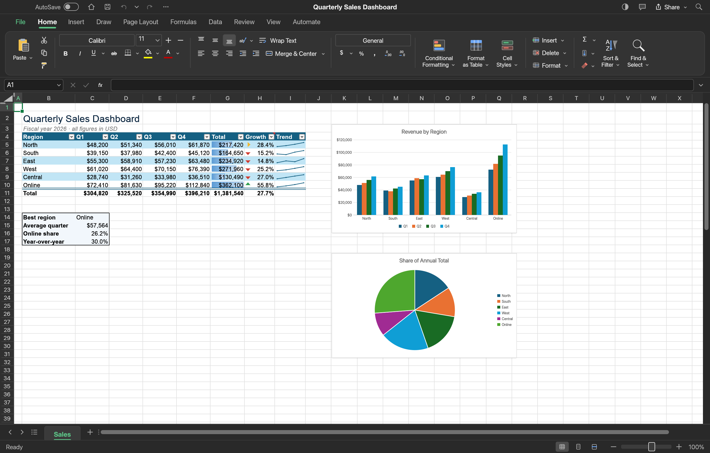
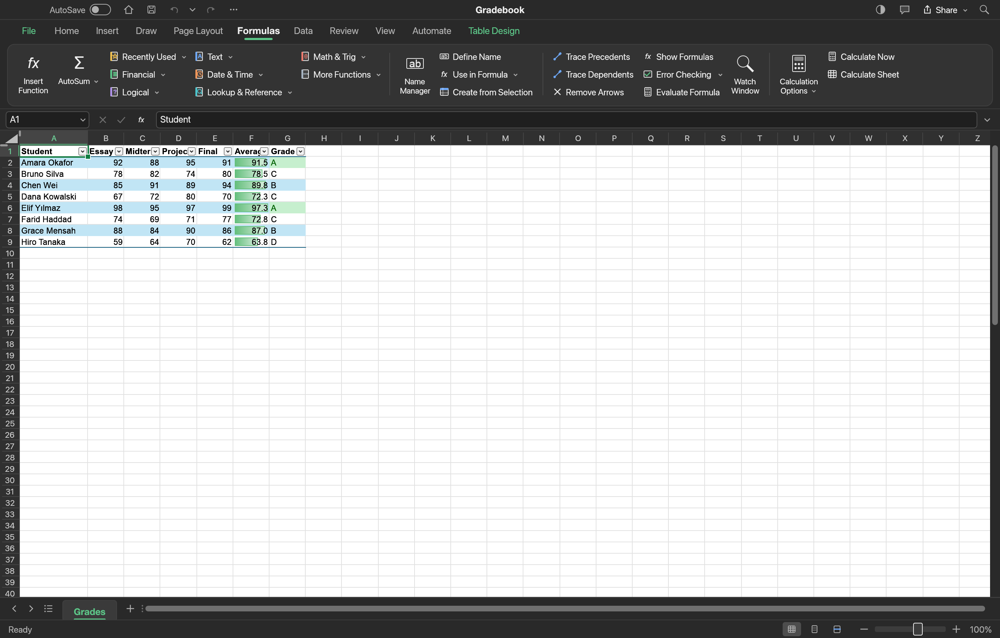
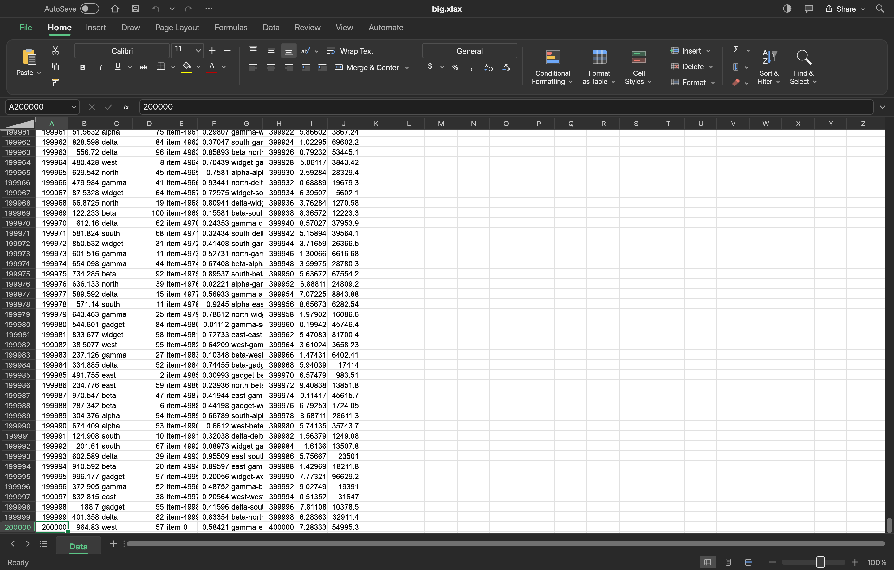

# Mac Excel

A native, Rust spreadsheet that clones Microsoft Excel: ribbon, formula bar, 500+ functions, dynamic arrays, charts, pivot tables and real XLSX files, with no update checks and no telemetry.

<p align="center">
  
</p>

<table>
<tr>
<td width="50%" valign="top"><p align="center"><sub><b>Formulas.</b> Function library, dynamic arrays, LET and LAMBDA.</sub></p></td>
<td width="50%" valign="top"><p align="center"><sub><b>Large files.</b> A 2-million-cell workbook opens whole.</sub></p></td>
</tr>
</table>

Mac Excel is built on [GridCraft](https://github.com/storytold/gridcraft) (`upstream` remote),
rebranded for macOS, with its update machinery removed and its memory use tuned for everyday Macs.
See [Differences from GridCraft](#differences-from-gridcraft).

## Features

- **Excel's interface.** Ribbon tabs, Quick Access Toolbar, formula bar with Name Box, sheet tabs,
  status-bar statistics, Format Cells, Paste Special, Find & Replace, Go To, fill handle,
  point-mode formula entry with coloured references, and Excel's keyboard shortcuts and key tips.
- **Calculation.** Dependency-graph engine with incremental recalculation, dynamic arrays and
  spilling, legacy Ctrl+Shift+Enter arrays, 500+ worksheet functions, LET, LAMBDA, MAP, REDUCE,
  SCAN, BYROW, BYCOL, structured table references, names, iterative calculation.
- **Data tools.** Sort, AutoFilter, tables, conditional formatting, data validation, Flash Fill,
  outlining and subtotals, Goal Seek, Solver, Analysis ToolPak, PivotTables with GETPIVOTDATA.
- **Charts.** Seventeen chart types with a Chart Design tab, Format pane, trendlines, data
  tables, and typed axis number formats (a scatter chart's date axis shows dates).
- **Files.** XLSX is the native format and round-trips styles, formulas, tables, charts, pivots,
  comments, validation and print settings. CSV/TSV, legacy `.xls` (including Excel's
  "HTML format" `.xls`), XLSB and ODS import; PDF export and printing.
- **Excel-accurate entry.** `+A1`, `-A1` and `+SUM(…)` start formulas as in Excel; `-5` stays a
  number and a lone `-` stays text.
- **Agent control.** Every command is reachable over a JSON control channel, an MCP server and a
  CLI (`mac-excel-cli`).
- **Lean.** An empty workbook uses about 31 MB of heap (see [Memory](#memory)); non-Latin
  fallback fonts load only when their script appears.
- **Private.** No update check, no update source, no telemetry. The app never phones home.

## Requirements

- macOS 11 (Big Sur) or later, Apple silicon or Intel (universal binary).
- To build from source: Rust 1.90+ via `rustup` (the build adds the `aarch64-apple-darwin` and
  `x86_64-apple-darwin` targets), Xcode Command Line Tools (`lipo`, `codesign`).
- About 10 GB of free disk space for a release build of both architectures.

## Install

### Prebuilt DMG

1. Run `./package.sh` (or take `release/MacExcel-<version>.dmg` from a previous run).
2. Open the DMG and drag **Mac Excel** onto **Applications**.
3. The app is ad-hoc signed. On first launch, right-click it in Applications and choose **Open**.

### Build from source

```bash
./build.sh            # debug build → ~/Library/Caches/MacExcelBuild/Mac Excel.app
```

```bash
./build.sh release    # optimised universal build, same location
```

```bash
./package.sh          # release build + release/MacExcel-<version>.dmg (with an Applications link)
```

The headless CLI is written next to the app as `~/Library/Caches/MacExcelBuild/mac-excel-cli`.

For development, the Cargo workspace runs directly:

```bash
cargo run --release -p gridcraft -- --sample sales
```

## Permissions

None are required. Opening and saving files goes through the standard macOS file dialogs. The
optional control channel (`--control <port>`) listens on `127.0.0.1` only and requires a token.

## Usage

| Action | Shortcut / interaction |
|---|---|
| Start a formula | `=`, `+` or `-`, then click or arrow to point at cells |
| Edit the active cell | F2 |
| Fill the selection with the entry | Ctrl+Enter |
| Insert Function | Shift+F3 |
| Save | ⌘S |
| Undo / Redo | ⌘Z / ⌘Y |
| Cut / Copy / Paste | ⌘X / ⌘C / ⌘V |
| Bold / Italic / Underline | ⌘B / ⌘I / ⌘U |
| AutoSum | ⌘⇧T |
| Insert Table | ⌘T |
| Insert Link | ⌘K |
| Filter | ⌘⇧F |
| Flash Fill | ⌘E |
| Show Formulas | ⌃` |
| Open a sample | `--sample sales`, `budget` or `grades` on the command line |
| Drive from scripts | `mac-excel-cli eval '=SUM(1,2,3)'`, `mac-excel-cli run --in a.xlsx --cmd …` |

## How it works

An engine-first Cargo workspace with enforced layering:

| Layer | Crates |
|---|---|
| L0 | `core` (addresses, values, dates, input parsing) · `numfmt` (number formats) |
| L1 | `formula` (parser, printer) · `functions` (worksheet functions, FILTERXML's XPath subset) |
| L2 | `model` (workbook, copy-on-write cell store, pivot aggregation) · `calc` (dependency graph, evaluator, spills) · `xlsx` (XLSX/CSV/XLS/HTML/XLSB/ODS) |
| L3 | `chart` (toolkit-free chart layout and rendering) |
| L5 | `engine` (session, commands, undo, clipboard, file I/O) |
| L6 | `ui-egui` (egui spreadsheet UI, control channel) · `mcp` (MCP server) |
| L7 | `apps/gridcraft` (desktop app), `apps/gridcraft-cli`, `apps/gridcraft-web` |

Cells live in 64-row bands behind `Arc`s, so an undo snapshot copies only band pointers and an
edit copies one band. Inside a band, each row is a sorted vector of `(column, cell)`, sized from
the row above it while a file loads. Worksheet XML is streamed row by row.

### Memory

Measured on an Apple-silicon Mac with the release build, live process after load (`heap` total /
`footprint`):

| Workload | Mac Excel |
|---|---|
| Empty workbook | 31 MB / 116 MB |
| 40,000 rows × 10 columns (400k cells) | 93 MB / 207 MB |
| 200,000 rows × 10 columns (2M cells) | loads all rows |

Fonts are the biggest lever: non-Latin fallback faces (macOS's Korean face alone is 55 MB,
Simplified Chinese 23 MB) are read only the first time that script shows up in a cell, sheet name,
comment, the cell editor, the interface language or the language picker.

### Differences from GridCraft

- **Identity.** Every name the app shows is Mac Excel (menus, About, messages, file properties).
- **Private.** No update check, self-updater, update source or ArtCraft links.
- **Formulas.** GETPIVOTDATA computed from the pivot definition; FILTERXML with a bounded XPath 1.0
  subset; COMPLEX / IM* text formatting matching Excel; `RATE` with no payment and no root returns
  `#NUM!`; `+`/`-` formula entry and point mode share one rule in `core`.
- **Spills.** Legacy arrays work over spills, a full recalc keeps spill ownership, a spill keeps its
  area through an XLSX save and reload, and spill clean-up scales linearly.
- **Files.** HTML-format `.xls` files open as data; very large sheets (over ~1M XML elements) load
  in full; typed chart axis number formats (`c:numFmt sourceLinked="0"`) and `filterPrivacy`
  round-trip, with an author scrub on save.
- **Formatting.** Borders on whole columns or rows are stored as a line format, and Draw Border is
  one undo step.
- **Clipboard.** Large copies reach the clipboard in full or fail with a clear message.
- **Memory.** On-demand script fallback fonts, rows stored as sorted vectors, inline-string
  interning and compaction after open.
- **Windows.** Closing the last window quits the app.

### Known limitations

- Not verified against desktop Excel on this machine; behaviour comes from Microsoft's public
  documentation (see `docs/gaps.md` for the ranked list of gaps).
- Ad-hoc signed, not notarized.
- Without the optional `craft-fonts` build input (`CRAFT_FONTS_DIR`), tests that draw Chinese,
  Japanese, Korean, Vietnamese or `ẞ` with egui's bundled faces are skipped (the app itself uses
  the system's fonts for them).
- Closing the last window quits the app (as on Windows and Linux). Keeping a windowless app
  running, as Excel for Mac does, would need the Dock icon to bring a window back, which the app
  cannot receive without unsafe Objective-C code.
- Internal crate names, the settings folder (`~/Library/Application Support/GridCraft`) and the
  docs in `docs/` keep the upstream name GridCraft; everything the app shows says Mac Excel.
- The upstream docs in `docs/` still describe the project as GridCraft.

## Project layout

```
mac-excel/
├── apps/
│   ├── gridcraft/          desktop app (egui window, native menus)
│   ├── gridcraft-cli/      headless CLI and MCP entry point
│   └── gridcraft-web/      WebAssembly build
├── crates/                 core, numfmt, formula, functions, model, calc, xlsx, chart,
│                           engine, ui-egui, mcp, pdf, math
├── docs/                   parity checklists, gaps, architecture, protocols
│   └── screenshots/        README screenshots
├── packaging/              upstream packaging (macOS/Windows/Linux/BSD)
├── xtask/                  CI helpers (layers, assets, parity, wasm)
├── build.sh                universal debug/release build of "Mac Excel.app"
└── package.sh              release build + versioned DMG in release/
```

## License

Dual-licensed under [MIT](LICENSE-MIT) or [Apache-2.0](LICENSE-APACHE), at your option, as
GridCraft is. Required notices are in [NOTICE](NOTICE); bundled assets and their licences are
listed in [ATTRIBUTION.md](ATTRIBUTION.md).
